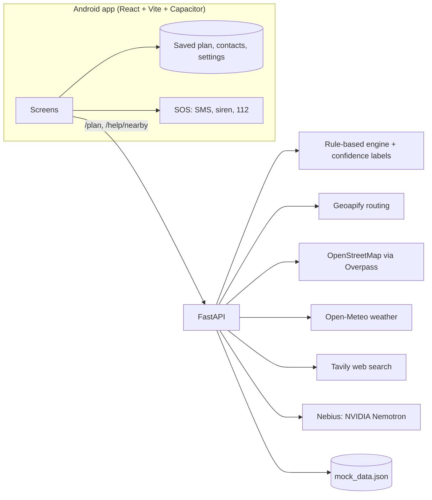

# NISAARTHI

**Theme 1 · Problem 1.1, "The City That Sleeps While You Work"**

A night-time decision engine for workers who head home after a late shift, starting with **nurses** and **delivery riders**. 52% of urban women in India feel unsafe at night. NISAARTHI answers one question:

> "I finish work at 2:15 AM and need to reach home by 3:00 AM. What is the safest plan that still gets me there?"

It ranks routes by how many places will **still be open when you pass them**, how evenly those places are spread, main roads, help points, turns, open transport and CCTV. It keeps re-planning while you travel, keeps working offline, and labels every piece of data as **KNOWN, PROBABLE, OUTDATED or UNKNOWN** instead of inventing information.

The Android app is React + Vite wrapped with Capacitor. The backend is Python + FastAPI with a rule-based engine.

---

## Build phases

| Phase | What | Status |
|---|---|---|
| 1 | Sign-up page: language, name, mobile, emergency contacts; stays signed in; works offline | **Done** |
| 2 | Trip page: source, optional stops, destination, departure time, arrival deadline, search | **Done** (team check pending) |
| 3 | Routes page: all routes by safety score, coverage-based shop spacing, open-when-you-reach, TomTom traffic, weather, Tavily incidents, Nemotron scores, booking links, police stations, siren | Planned |
| 4 | Safety layer: shake opens the app even when closed, automatic offline SOS SMS, siren | Planned |
| 5 | Feedback loop: post-trip ratings and corrections improve scores | Planned |
| 6 | Novelty, "Rider Eyes": delivery riders' phones act as moving CCTV, live street lighting and activity scores | Street check built and runs on TrafficCAM; phone capture and map planned |
| 7 | 12 regional languages and the hand-drawn Madhubani redesign | Planned |

### Phase 2 details

- From: current location by default, or search. To and up to 3 stops: search. Every search dropdown ends with **Choose on map** for addresses search can't find.
- Search goes through the backend (`/places/search`), so the Geoapify key never ships in the app. It prefers places near you or central Nagpur and allows about 40 km around (Hingna, Kamptee, Butibori MIDC). Change with `CITY_LAT`, `CITY_LON`, `SEARCH_RADIUS_KM`.
- Without a key or internet: last cached results, then sample Nagpur places (labelled Outdated), then places picked before on this phone.
- Search routes opens the current results screen until Phase 3 replaces it.

### Phase 1 details

- No OTP (team decision). Sign-up returns a long random token the phone keeps, so the user is never asked to log in again. The server stores only a hash of the token.
- Sign-up never blocks on the internet. The account is saved on the phone first and sent to the server as soon as there is a connection; contact edits sync the same way.
- Mobile numbers are checked as Indian mobiles (10 digits starting 6–9, with or without +91 or 0). An emergency contact can't be the user's own number. 1 to 5 contacts.
- Reinstalling the app creates a new account, because there is no OTP to prove who owns a number.

---

## Street check on real Indian CCTV (TrafficCAM)

The image processing behind Rider Eyes, already working on real fixed-camera footage from Indian cities.

**Dataset:** TrafficCAM, about 2,100 short clips (30 frames each) from fixed traffic cameras in eight Indian cities, day and night, with annotations of vehicles and pedestrians. Each clip folder is named `<CITY>_<unix time>`, so night clips are picked out by their recording time. Website: https://math-ml-x.github.io/TrafficCAM/

> Cite: Z. Deng et al., "TrafficCAM: A Versatile Dataset for Traffic Flow Segmentation," IEEE Transactions on Intelligent Transportation Systems. The dataset repository has no licence file, so we credit it and never commit its images; each person downloads it with the script.

**What the street check measures in each frame** (`backend/app/vision/street_check.py`):

| Measure | Meaning |
|---|---|
| Brightness | Average light level of the scene |
| Dark share | How much of the frame is very dark |
| Light sources | How much is very bright: street lights, shopfronts, headlights |
| Infrared mode | The camera switched to black-and-white infrared, which CCTV does when a street is poorly lit |
| People, vehicles | Activity on the street, from the dataset's annotations (or a detector later) |

These combine into a **lighting score**, an **activity score**, a **street score** (0–100), and a verdict: well-lit and busy, well-lit and quiet, dim, or dark and empty. It needs only numpy and Pillow, no GPU.

**Run it:**

```bash
cd backend
bash scripts/download_trafficcam.sh                      # about 2,100 clips from Google Drive
python scripts/build_street_index.py --night-only --sheet
```

This prints a summary (night clips per city, how many night cameras were in infrared mode, verdicts) and saves:
- `data/street_index.json`: scores for every clip, served at `GET /street-check/trafficcam`
- `data/night_contact_sheet.jpg`: the darkest and best-lit night clips with their scores, for the pitch (not committed)

`POST /street-check` scores any single photo, which is what Rider Eyes will send from riders' phones in Phase 6.

---

## Feature status

### From our notes

| # | Feature | Status | Where |
|---|---|---|---|
| 1 | SMS fallback | Built | `mobile/src/lib/sos.js` (works with no internet) |
| 2 | Location coordinates via SMS | Built | SOS SMS contains lat/lon and a map link |
| 3 | Scattered shops (evenly spread, not clustered) | Built | `spacing` factor and the dot strip on the result screen |
| 4 | Shake to open | Built | `onShake` in `mobile/src/lib/native.js`, with a 5-second cancel window |
| 5 | Loud siren | Built | Web Audio siren plus vibration, no sound file needed |
| 6 | Offline mode | Built | Last plan and help list saved on the phone; server falls back to cache, then mock |
| 7 | Multiple languages | Built | English, हिंदी, मराठी (`mobile/src/i18n.js`) |
| 8 | Mock data file | Built | `backend/data/mock_data.json` (sample Nagpur trip, not real places) |
| 9 | Tavily API, web search | Built | Night-safety incident and road-closure reports (`backend/app/services/tavily.py`) |
| 10 | Nebius Token Factory, NVIDIA Nemotron safety/feasibility score | Built | `backend/app/services/nebius.py` |
| 11 | Direct links to booking apps | Built | Uber, Ola, Rapido buttons on the result screen |
| 12 | Save emergency contacts | Built | Up to 5, stored on the phone |
| 13 | Nearby police stations | Built | Help tab, from OpenStreetMap |
| 14 | Peer to peer | **Pending, needs definition from the team** | Not built |

### Route engine (reliability score)

| Factor | Weight | How it is measured |
|---|---|---|
| Open places along the route | 0.20 | Shops, food stalls, pharmacies, petrol pumps, ATMs within 150 m that are open **at the time you pass them** |
| Fewer gaps between open places | 0.20 | Longest stretch with nothing open (≤300 m best, ≥1.5 km worst) |
| Distance on main roads | 0.15 | Share of the route on motorway, trunk, primary or secondary roads |
| Open help points nearby | 0.15 | Police, hospitals and open pharmacies within 500 m |
| Fewer turns | 0.10 | Turns per km |
| Transport locations listed open | 0.10 | Auto, taxi, bus and rail points with opening hours that say open |
| CCTV cameras | 0.10 | OpenStreetMap `man_made=surveillance` per km |

A factor with no data is marked UNKNOWN and left out; the remaining weights are rescaled. Bad weather lowers the score (never raises it). Routes are ranked **safest feasible first**: a route that gets you home by your deadline beats a safer one that makes you late.

### From the problem statement (approved additions)

| Requirement | Status |
|---|---|
| KNOWN → PROBABLE → OUTDATED → UNKNOWN labels | Built on every factor, place, weather and report. Saved KNOWN data turns OUTDATED on the phone after 15 minutes. |
| Worker's shift timing | Built: "Shift ends at" and "Reach home by" inputs; opening hours are checked at the time you pass |
| Weather | Built, via Open-Meteo (free, no key) |
| Road closures | Built as web reports via Tavily, labelled PROBABLE |
| Continuously update the plan | Built: re-plans every 2 minutes from your current location while the route screen is open |

### From image 6 (future scope)

| Idea | Status |
|---|---|
| CCTV footage | Future scope: needs access to camera feeds |
| GPS trackers (police) | Future scope: needs police data access |
| CCTV image processing | Future scope |
| Item 4 ("Novelty: Missing 99"?) | **Pending, the team to confirm what this is** |

CCTV *locations* from OpenStreetMap are already used in the score.

---

## Architecture



Every live source falls back in the same order: **live → last cached copy (labelled by age) → mock data → UNKNOWN**. API keys stay on the server and are never shipped inside the app.

---

## Run it

### 1. Backend

```bash
cd backend
python -m venv .venv && source .venv/bin/activate   # Windows: .venv\Scripts\activate
pip install -r requirements.txt
cp .env.example .env          # add keys; every key is optional
uvicorn app.main:app --host 0.0.0.0 --port 8000 --reload
```

Open http://localhost:8000/docs to try the API. Without any keys, or with `FORCE_MOCK=1`, it runs entirely on the sample data.

Tests: `python -m pytest tests`

User accounts are stored in `backend/data/nisaarthi.db` (SQLite, created automatically, not committed to git).

### 2. App in the browser (fastest for UI work)

```bash
cd mobile
npm install
cp .env.example .env          # VITE_API_URL=http://localhost:8000 for the browser
npm run dev
```

Open the URL Vite prints, then use your browser's mobile device view.

### 3. Android

Needs Android Studio and JDK 17.

```bash
cd mobile
npm install
npm run build
npx cap add android           # first time only, creates mobile/android
```

Then add these lines to `mobile/android/app/src/main/AndroidManifest.xml`, inside `<manifest>` and above `<application>`:

```xml
<uses-permission android:name="android.permission.ACCESS_COARSE_LOCATION" />
<uses-permission android:name="android.permission.ACCESS_FINE_LOCATION" />
<uses-permission android:name="android.permission.VIBRATE" />
<uses-feature android:name="android.hardware.location.gps" android:required="false" />
<queries>
  <intent><action android:name="android.intent.action.VIEW" /><data android:scheme="sms" /></intent>
  <intent><action android:name="android.intent.action.VIEW" /><data android:scheme="tel" /></intent>
  <intent><action android:name="android.intent.action.VIEW" /><data android:scheme="geo" /></intent>
  <intent><action android:name="android.intent.action.VIEW" /><data android:scheme="https" /></intent>
</queries>
```

Then:

```bash
npm run android               # builds, syncs and opens Android Studio; press Run
```

Server address inside the app: the emulator reaches your computer at `http://10.0.2.2:8000`. A real phone on the same Wi-Fi uses `http://<your-computer-LAN-IP>:8000`. Change it any time under **Settings** in the app.

To build an APK in Android Studio: **Build → Build Bundle(s) / APK(s) → Build APK(s)**.

---

## API

| Method | Path | Purpose |
|---|---|---|
| GET | `/health` | Which sources have keys, and whether mock mode is on. Add `?check=true` to test each key with one live call (working / not_set / rejected / model_not_found / error) |
| GET | `/demo` | The sample trip (Nagpur, 2:15 AM → 3:00 AM, walking) |
| GET | `/places/search?text=&lat=&lon=` | Place autocomplete (Geoapify) within 40 km of Nagpur; falls back to cache, then sample places |
| POST | `/plan` | `{origin, destination, stops (0–3), departure, deadline, mode}` → ranked routes with scores, factors, labels, places, weather, reports, AI estimate |
| POST | `/users` | Sign up: `{name, phone, language, contacts[]}` → `{user, token}` |
| GET | `/users/me` | Current user (header `Authorization: Bearer <token>`) |
| PATCH | `/users/me` | Change name or language |
| PUT | `/users/me/contacts` | Replace emergency contacts |
| GET | `/help/nearby?lat=&lon=` | Police, hospitals and pharmacies within 3 km, with open status |

---

## Repo layout

```
backend/
  app/
    main.py              FastAPI routes
    users.py             accounts and emergency contacts (SQLite)
    planner.py           live → cache → mock fallback, scoring, ranking
    engine/
      scoring.py         reliability score, feasibility, reasons
      hours.py           OpenStreetMap opening_hours parser ("open when you pass")
      confidence.py      KNOWN / PROBABLE / OUTDATED / UNKNOWN
      geo.py
    services/            geoapify, overpass, weather, tavily, nebius, mockdata, cache
    vision/
      street_check.py    lighting, infrared and activity scores for a frame or clip
      trafficcam.py      reads the TrafficCAM dataset (city, recording time, annotations)
  scripts/
    download_trafficcam.sh
    build_street_index.py
  data/
    mock_data.json       sample trip and places (not real)
    make_mock_data.py    regenerates it
  tests/test_engine.py
mobile/
  src/
    screens/             SignUp, Home, Plan, Help, Contacts, Settings
    components/          SOS sun button, score ring, spacing strip, map, confidence chip
    lib/                 native plugins, SOS (SMS, siren), time, labels
    i18n.js              English, Hindi, Marathi
  public/madhubani-tile.svg   the faded background print
  capacitor.config.json
```

---

## Design

Night indigo base, chosen because the app is opened at 2 AM. An original Madhubani-style line print (fish, lotus, sun, leaf, dot rows) sits behind everything at about 7% opacity. All text is on near-opaque surfaces, so the print never affects readability. Accents come from the Madhubani palette: sindoor red for SOS, haldi yellow for actions, neem green for good and known. Fonts are Yatra One for headings and Mukta for text, both bundled so they work offline and render Devanagari properly. Confidence labels use colour, a symbol and a word, so they never depend on colour alone.

---

## Known limits

- **SMS:** SOS opens the phone's SMS app with all contacts and the location already filled in; one tap sends it. Fully automatic sending needs the `SEND_SMS` permission and a native plugin, which Google Play restricts.
- **Shake:** works while the app is open or in recent use. Shake-to-SOS when the app is fully closed needs an Android background service.
- **Map tiles:** use the public OpenStreetMap tile server, fine for a demo. For heavy use, switch to a tile provider such as Geoapify or MapTiler. Offline, tiles don't load, but the plan is still shown as text.
- **Opening hours:** come from OpenStreetMap, which is incomplete in many Indian areas. Missing or unreadable hours are shown as UNKNOWN, never guessed.
- **Ola and Rapido links:** the Ola link pre-fills pickup and drop; Rapido opens its site/app without pre-filled locations.
- **Nemotron model ID:** copy the exact ID from the Token Factory catalog into `NEBIUS_MODEL`. `/health?check=true` lists the Nemotron IDs your key can use if the one set is wrong.
- **Siren volume:** follows the phone's media volume.
