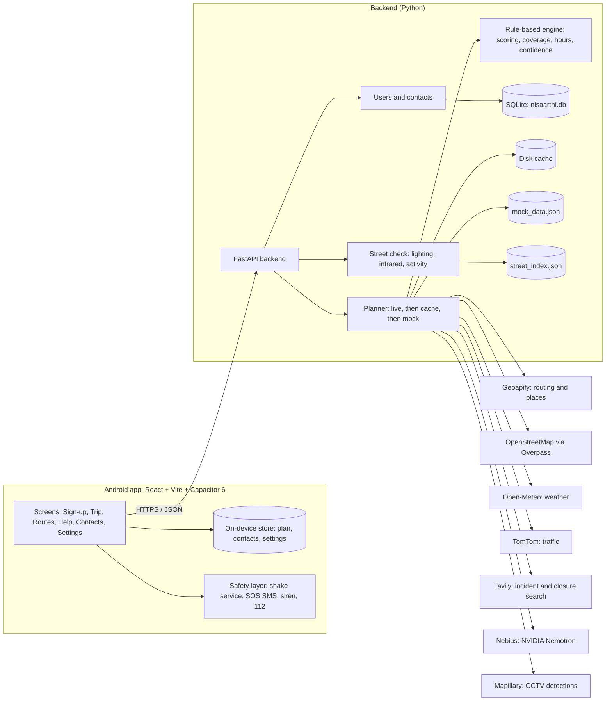
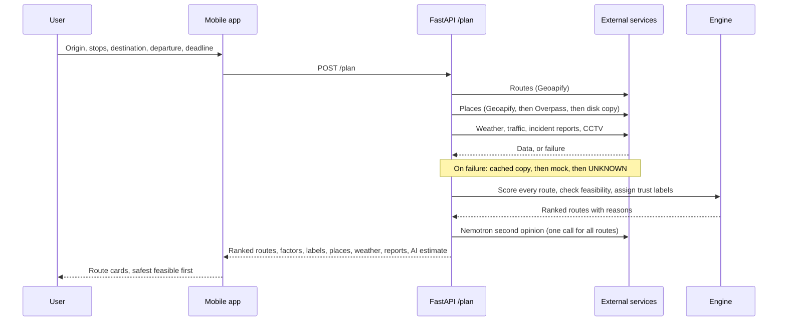

# NISAARTHI

**A night-time decision engine for workers who travel home after late shifts.**

> *"I finish work at 2:15 AM and need to reach home by 3:00 AM. What is the safest plan that still gets me there?"*


Built for **CASCADE '26** (24-hour hackathon, IIIT Nagpur, TantraFiesta 2026) · Theme 1: *The Forgotten Population* · Problem 1.1: *The City That Sleeps While You Work*. Demo city: **Nagpur**.

---

## Table of contents

1. [Overview](#1-overview)
2. [Key features](#2-key-features)
3. [System architecture](#3-system-architecture)
4. [Technology stack](#4-technology-stack)
5. [External API integrations](#5-external-api-integrations)
6. [Decision engine](#6-decision-engine)
7. [Data trust model](#7-data-trust-model)
8. [Resilience and offline behaviour](#8-resilience-and-offline-behaviour)
9. [Safety layer (Android)](#9-safety-layer-android)
10. [Street check (computer vision)](#10-street-check-computer-vision)
11. [Backend API reference](#11-backend-api-reference)
12. [Data storage](#12-data-storage)
13. [Security and privacy](#13-security-and-privacy)
14. [Repository structure](#14-repository-structure)
15. [Getting started](#15-getting-started)
16. [Configuration](#16-configuration)
17. [Testing](#17-testing)
18. [Design system](#18-design-system)
19. [Known limitations](#19-known-limitations)
20. [Roadmap](#20-roadmap)
21. [Credits](#21-credits)

---

## 1. Overview

Millions of nurses, security guards, factory staff and delivery riders travel home between midnight and dawn. Mainstream navigation treats night as just another timestamp: it does not know which shops will still be open when you pass them, whether the last bus has gone, or how much of your route is dark and empty.

NISAARTHI evaluates whether a night-time journey is **feasible**, ranks routes by how well the street is covered by **places that will still be open at the moment you pass them**, and shows the evidence behind every score. When data is missing it says so, labelling each fact **KNOWN, PROBABLE, OUTDATED or UNKNOWN**, instead of inventing information.

**Core principles**

- **Deterministic engine decides.** Route scoring, feasibility and ranking come from a rule-based engine. The AI model provides a second opinion only and never changes the ranking.
- **Never invent data.** Missing data is UNKNOWN, never assumed safe.
- **Always degrade gracefully.** Every live source falls back to a cached copy, then to sample data, then to UNKNOWN.
- **Safety first.** Emergency contacts, offline SOS SMS and a siren are part of the core product.

---

## 2. Key features

| Area | Capability |
|---|---|
| **Trip planning** | Source (current location or search), up to 3 optional stops, destination, departure time and arrival deadline. Every search dropdown ends with **Choose on map** for addresses that search can't find. |
| **Route ranking** | All routes shown as cards, safest feasible route first. Each card shows score, arrival time, minutes to spare, route coverage by open places, and places with unknown hours. |
| **Coverage scoring** | Rewards even coverage along the whole route, not shop count: share of the route within 300 m of a place open when you reach it, and the longest dark stretch. |
| **Open when you pass** | Opening hours are checked at the time you reach each place. A shop closing within 10 minutes of your arrival counts as risky. |
| **Live context** | Traffic (TomTom), weather (Open-Meteo), past incidents and road closures (Tavily), AI safety estimate (Nebius, NVIDIA Nemotron). |
| **Continuous re-planning** | Re-plans every 2 minutes from your current location while the route screen is open. |
| **Help finder** | Nearby police stations, hospitals and pharmacies (within 3 km) with open status. |
| **Booking links** | Direct links to Uber, Ola and Rapido. |
| **SOS** | Shake-to-SOS during a trip (works with the app closed), automatic offline SMS with your location to all emergency contacts, loud siren. |
| **Offline mode** | Last plan, help list and contacts saved on the phone; the server falls back to cache, then sample data. |
| **Languages** | English, हिंदी, मराठी. |
| **Trust labels** | Every factor, place, weather reading and report carries KNOWN / PROBABLE / OUTDATED / UNKNOWN. |

---

## 3. System architecture

### 3.1 High-level architecture



### 3.2 Plan request flow



### 3.3 Design guarantees

| Guarantee | How it is enforced |
|---|---|
| Keys never reach the device | All provider calls are made by the backend. Place search is proxied through `/places/search`. |
| AI never decides | Nemotron output is attached to results but does not change the ranking. |
| No fabricated live data | Every source has the fallback order live, cached (labelled by age), mock, UNKNOWN. Sample places are never used for a real trip. |
| Missing evidence is not safety | A factor with no data is marked UNKNOWN and excluded, and weights are rescaled. |

---

## 4. Technology stack

| Layer | Technology |
|---|---|
| **Mobile and web UI** | React, Vite |
| **Android packaging** | Capacitor 6 |
| **Android native** | Kotlin (foreground service, accelerometer, SMS) |
| **Backend** | Python, FastAPI, Uvicorn |
| **Database** | SQLite |
| **Computer vision** | NumPy, Pillow (CPU only) |
| **Maps** | OpenStreetMap tiles (demo), Geoapify routing and places |
| **Testing** | pytest, Kotlin unit tests |
| **Android build** | Android Studio JDK 21, Gradle 8.x, Android Gradle Plugin 8.2.1, minimum Android 8.0 |
| **Fonts** | Yatra One (headings), Mukta (body), bundled for offline use with Devanagari support |
| **Internationalisation** | Custom dictionaries in `mobile/src/i18n.js` |

---

## 5. External API integrations

All integrations run server-side. Every key is optional: without keys, or with `FORCE_MOCK=1`, the backend runs entirely on sample data.

| Service | Purpose | Behaviour and fallbacks |
|---|---|---|
| **Geoapify** | Route generation and place autocomplete / places | Search is proxied through the backend so the key never ships in the app. Allowed radius about 40 km around Nagpur. Falls back to cached results, then sample Nagpur places labelled OUTDATED, then places previously picked on the phone. |
| **OpenStreetMap (Overpass API)** | Places with opening hours, police, hospitals, pharmacies, CCTV points | Fallback after Geoapify Places. Results cached on disk for 24 hours per 3 km square. |
| **Open-Meteo** | Weather along the route | Free, no key. Bad weather lowers the score and never raises it. |
| **TomTom** | Live traffic | Used for two-wheeler and car trips leaving within 30 minutes. Otherwise a time-of-night estimate labelled PROBABLE. |
| **Tavily** | Past incidents and road-closure reports | Searches the 3 longest named roads of each route. An article is kept only if it names the full road, and is shown with its date. Over one year old is OUTDATED. Cached for 7 days. Road closures are labelled PROBABLE. |
| **Nebius Token Factory (NVIDIA Nemotron)** | AI safety and feasibility estimate | One call for all routes. Second opinion only, never alters ranking. Model is selected with `NEBIUS_MODEL`. |
| **Mapillary** | CCTV camera detections from street photos | PROBABLE. Requires `MAPILLARY_TOKEN`. Areas nobody has surveyed are UNKNOWN, not zero. |
| **Uber, Ola, Rapido** | Booking deep links | The Ola link pre-fills pickup and drop. Rapido opens without pre-filled locations. |
| **TrafficCAM dataset** | Street-check development data | Never committed. Downloaded with a script. See [Credits](#21-credits). |

---

## 6. Decision engine

The engine lives in `backend/app/engine/` and is fully rule-based, so every result can be explained and tested.

### 6.1 Reliability score

| Factor | Weight | How it is measured |
|---|---|---|
| Open places along the route | 0.20 | Shops, food stalls, pharmacies, petrol pumps and ATMs within 150 m that are open **at the time you pass them** |
| Fewer gaps between open places | 0.20 | Longest stretch with nothing open (300 m or less is best, 1.5 km or more is worst) |
| Distance on main roads | 0.15 | Share of the route on motorway, trunk, primary or secondary roads |
| Open help points nearby | 0.15 | Police, hospitals and open pharmacies within 500 m |
| Fewer turns | 0.10 | Turns per km |
| Open transport points | 0.10 | Auto, taxi, bus and rail points whose listed hours say open |
| CCTV cameras | 0.10 | Camera locations per km (cameras within 50 m count once) from Mapillary detections (PROBABLE) and OpenStreetMap `man_made=surveillance` |

A factor with no data is marked UNKNOWN and left out, and the remaining weights are rescaled.

### 6.2 Coverage scoring (`coverage.py`)

Coverage reflects the team's requirement to reward **coverage, not count**:

- Share of the route within **300 m** of a place open when the user reaches it.
- Longest dark stretch. Darkness near the destination is weighted worse.
- Diminishing returns for each extra shop.
- Unknown opening hours never count as open. Police stations and hospitals count as half cover (PROBABLE).
- Example: a route with 5 shops spread evenly to the destination beats one with 10 shops clustered at the start.

### 6.3 Feasibility and ranking

Routes are ranked **safest feasible first**. A route that gets the user home by the deadline beats a safer route that makes them late. Each route carries its arrival time, minutes to spare and the reasons for its score. Opening hours are parsed from OpenStreetMap `opening_hours` by `hours.py`, so "open" is evaluated at the time the user will actually pass each place.

### 6.4 Worker context

The trip screen takes the worker's shift end time and the time they must reach home. Opening hours are evaluated against those times, not against the current clock.

---

## 7. Data trust model

Every factor, place, weather reading and report carries one of four labels, assigned by `confidence.py`.

| Label | Meaning | Example |
|---|---|---|
| **KNOWN** | Recent, credible source supports the fact | Route duration from a fresh routing response |
| **PROBABLE** | Credible but indirect or not live-confirmed | Published opening hours, police counted as half cover, time-of-night traffic estimate, web-reported road closure |
| **OUTDATED** | Information past its freshness limit | Saved KNOWN data on the phone after 15 minutes, news older than one year |
| **UNKNOWN** | Not enough evidence to say anything | Place with missing hours, area never surveyed for CCTV |

Rules: UNKNOWN never means safe. Unknown opening hours never count as open. The coverage label takes the worst label among nearby places. Labels use colour, a symbol and a word, so they never depend on colour alone.

---

## 8. Resilience and offline behaviour

**Fallback order for every live source:**

```
live  →  last cached copy (labelled by age)  →  mock data  →  UNKNOWN
```

| Situation | Behaviour |
|---|---|
| No API key | That source is skipped. The backend still runs, down to full mock mode (`FORCE_MOCK=1`). |
| Provider failure or no internet | Cached copy with its age shown, then sample data, then UNKNOWN. |
| Place search offline | Last cached results, then sample Nagpur places (labelled OUTDATED), then places previously picked on the phone. |
| No internet on the phone | The last plan and help list are shown from device storage. Tiles don't load but the plan still shows as text. |
| Sign-up offline | The account is saved on the phone first and sent to the server when a connection returns. Contact edits sync the same way. |
| SOS offline | SMS is sent by the phone itself and needs no internet. |

`GET /health` reports which sources have keys and whether mock mode is on. `GET /health?check=true` tests each key with one live call and reports `working`, `not_set`, `rejected`, `model_not_found` or `error`.

---

## 9. Safety layer (Android)

The native Android code lives in `mobile/android/app/src/main/java/in/nisaarthi/app/`.

| Component | Detail |
|---|---|
| **Shake service** | `ShakeService.kt` is a foreground service that listens to the accelerometer with the app closed or the screen locked. It shows a quiet "Shake for SOS is on" notification with an **End trip** button. |
| **When it runs** | Only during a trip. It starts when **Search routes** opens the routes page. It stops on **End trip**, on arrival (a re-plan finds you within 150 m of the destination), or one hour after the reach-by time. |
| **Trigger** | Three hard shakes start a 5-second countdown with vibration and a **Cancel** button (in the notification and on screen, shown over the lock screen). |
| **SOS action** | SOS SMS with latitude, longitude and a map link goes to every emergency contact using `SEND_SMS`, with no internet needed. Then the siren plays at full alarm volume (configurable: "Play siren with SOS"). |
| **Sensitivity** | Hard (4 strong jolts, suits two-wheeler riders), Normal, Light. |
| **Siren** | Web Audio siren plus vibration, no sound file needed. Buttons on the trip and routes pages. |
| **Permission helper** | The routes page shows protection status with one-tap fixes for SMS permission, notifications, full-screen alerts and battery optimisation. |
| **Emergency contacts** | 1 to 5 contacts, stored on the phone. Indian mobile validation (10 digits starting 6 to 9, with or without +91 or 0). A contact cannot be the user's own number. |
| **Native tests** | `ShakeDetectorTest.kt`: walking never triggers, one bump counts once, cooldown, sensitivity levels, SMS text. |

Outside a trip, or in the browser, the SOS button opens the SMS app with the message pre-filled, and one tap sends it.

---

## 10. Street check (computer vision)

`backend/app/vision/street_check.py` scores how a street looks from a camera frame, using only NumPy and Pillow (no GPU). It was developed and tested on real fixed-camera footage from Indian cities (TrafficCAM: about 2,100 short clips from eight cities, day and night, with vehicle and pedestrian annotations).

| Measure | Meaning |
|---|---|
| Brightness | Average light level of the scene |
| Dark share | How much of the frame is very dark |
| Light sources | How much is very bright: street lights, shopfronts, headlights |
| Infrared mode | The camera switched to black-and-white infrared, which CCTV does on poorly lit streets |
| People and vehicles | Street activity from dataset annotations (or a detector later) |

These combine into a **lighting score**, an **activity score**, a **street score (0 to 100)** and a verdict: *well-lit and busy*, *well-lit and quiet*, *dim*, or *dark and empty*.

**Run it**

```bash
cd backend
bash scripts/download_trafficcam.sh                      # about 2,100 clips
python scripts/build_street_index.py --night-only --sheet
```

Outputs: `data/street_index.json` (served at `GET /street-check/trafficcam`) and `data/night_contact_sheet.jpg` (for presentations, not committed). `POST /street-check` scores any single photo.

---

## 11. Backend API reference

Interactive docs at `http://localhost:8000/docs` (FastAPI Swagger UI). Authenticated endpoints use `Authorization: Bearer <token>`.

| Method | Path | Purpose |
|---|---|---|
| `GET` | `/health` | Which sources have keys and whether mock mode is on. Add `?check=true` for live key checks. |
| `GET` | `/demo` | Sample trip (Nagpur, 2:15 AM to 3:00 AM, walking) |
| `GET` | `/places/search?text=&lat=&lon=` | Place autocomplete (Geoapify) within about 40 km of Nagpur, with cache and sample fallbacks |
| `POST` | `/plan` | `{origin, destination, stops (0 to 3), departure, deadline, mode}` returns ranked routes with scores, factors, labels, places, weather, reports and AI estimate |
| `POST` | `/users` | Sign up: `{name, phone, language, contacts[]}` returns `{user, token}` |
| `GET` | `/users/me` | Current user |
| `PATCH` | `/users/me` | Change name or language |
| `PUT` | `/users/me/contacts` | Replace emergency contacts |
| `GET` | `/help/nearby?lat=&lon=` | Police, hospitals and pharmacies within 3 km with open status |
| `GET` | `/street-check/trafficcam` | Street-check scores for the TrafficCAM clips |
| `POST` | `/street-check` | Score a single photo |

---

## 12. Data storage

| Store | Location | Contents |
|---|---|---|
| **User database** | `backend/data/nisaarthi.db` (SQLite, auto-created, not committed) | User accounts and emergency contacts. Only a hash of the session token is stored. |
| **Place cache** | Disk | Nearby places, 24 hours, per 3 km square |
| **Incident cache** | Disk | Tavily results, 7 days |
| **Mock data** | `backend/data/mock_data.json` | Sample Nagpur trip and places (not real). Regenerated by `make_mock_data.py`. |
| **Street index** | `backend/data/street_index.json` | Street-check scores for TrafficCAM clips |
| **On the phone** | Device storage | Last plan, help list, contacts, settings, and the account until it syncs |

---

## 13. Security and privacy

- **No secrets in the app.** API keys live only in `backend/.env` and are never shipped inside the app.
- **Hashed session tokens.** Sign-up returns a long random token that the phone keeps. The server stores only its hash.
- **No OTP.** A team decision to keep the sign-up friction-free for shift workers. Consequence: reinstalling the app creates a new account, because there is nothing to prove who owns a number.
- **Offline-first sign-up.** The account is created on the device first and synced later.
- **Input validation.** Indian mobile number format, 1 to 5 contacts, no self-contact.
- **Location use.** Location is used for planning, re-planning and the SOS message. SOS messages go from the phone to the user's own contacts.
- **Dataset hygiene.** TrafficCAM images are never committed (`backend/datasets/` is git-ignored). Each user downloads them with the script.
- **Planned privacy rule for Rider Eyes:** only scores are stored, images are deleted and faces are never kept.

---

## 14. Repository structure

```
backend/
  app/
    main.py               FastAPI routes
    users.py              accounts and emergency contacts (SQLite)
    planner.py            live → cache → mock fallback, scoring, ranking
    engine/
      scoring.py          reliability score, feasibility, reasons
      coverage.py         coverage-based scoring of open places
      hours.py            OpenStreetMap opening_hours parser ("open when you pass")
      confidence.py       KNOWN / PROBABLE / OUTDATED / UNKNOWN
      geo.py              geometry helpers
    services/             geoapify, overpass, weather, tavily, nebius, mockdata, cache
    vision/
      street_check.py     lighting, infrared and activity scores
      trafficcam.py       reads the TrafficCAM dataset
  scripts/
    download_trafficcam.sh
    build_street_index.py
  data/
    mock_data.json        sample trip and places (not real)
    make_mock_data.py     regenerates the sample data
  tests/test_engine.py
mobile/
  src/
    screens/              SignUp, Home, Plan, Help, Contacts, Settings
    components/           SOS sun button, score ring, spacing strip, map, confidence chip
    lib/                  native plugins, SOS (SMS, siren), time, labels
    i18n.js               English, Hindi, Marathi
  public/madhubani-tile.svg
  android/                native Android project (Kotlin shake service)
  capacitor.config.json
docs/
CLAUDE.md                 working notes for AI-assisted development
README.md
```

---

## 15. Getting started

### 15.1 Prerequisites

- Python 3 and `pip`
- Node.js and `npm`
- For Android: Android Studio (its bundled JDK 21 works; a newer system Java breaks Gradle 8.x), Android SDK, a device or emulator running Android 8.0 or later

### 15.2 Backend

```bash
cd backend
python -m venv .venv && source .venv/bin/activate     # Windows: .venv\Scripts\activate
pip install -r requirements.txt
cp .env.example .env                                  # add keys; every key is optional
uvicorn app.main:app --host 0.0.0.0 --port 8000 --reload
```

Open <http://localhost:8000/docs>. With no keys, or with `FORCE_MOCK=1`, it runs entirely on sample data.

### 15.3 App in the browser (fastest for UI work)

```bash
cd mobile
npm install
cp .env.example .env          # VITE_API_URL=http://localhost:8000
npm run dev
```

Open the URL Vite prints and use your browser's mobile device view.

### 15.4 Android

`mobile/android` is committed, including the native shake-for-SOS code.

```bash
cd mobile
npm install
npm run android               # builds the web app, syncs into android/, opens Android Studio; press Run
```

Command-line build (Windows, Git Bash):

```bash
cd mobile && npm run build && npx cap sync android
cd android
echo 'sdk.dir=C:/Users/<you>/AppData/Local/Android/Sdk' > local.properties   # first time only
JAVA_HOME="/c/Program Files/Android/Android Studio/jbr" ./gradlew assembleDebug testDebugUnitTest
# APK: app/build/outputs/apk/debug/app-debug.apk
```

**Server address inside the app:** the emulator reaches your computer at `http://10.0.2.2:8000`. A real phone on the same Wi-Fi uses `http://<your-computer-LAN-IP>:8000`. Change it any time under **Settings**.

To build an APK in Android Studio: **Build → Build Bundle(s) / APK(s) → Build APK(s)**.

---

## 16. Configuration

Copy `backend/.env.example` to `backend/.env` and `mobile/.env.example` to `mobile/.env`. **Never commit `.env` files.** Every backend key is optional.

| Variable | Where | Purpose |
|---|---|---|
| Geoapify key | `backend/.env` | Routing, place search, places |
| TomTom key | `backend/.env` | Live traffic |
| Tavily key | `backend/.env` | Incident and closure search |
| Nebius key | `backend/.env` | Nemotron access |
| `NEBIUS_MODEL` | `backend/.env` | Exact Nemotron model ID from the Token Factory catalog. `/health?check=true` lists IDs your key can use if this one is wrong. |
| `MAPILLARY_TOKEN` | `backend/.env` | CCTV camera detections |
| `CITY_LAT`, `CITY_LON` | `backend/.env` | City centre for search bias (defaults to central Nagpur) |
| `SEARCH_RADIUS_KM` | `backend/.env` | Search radius (about 40 km by default; covers Hingna, Kamptee, Butibori MIDC) |
| `FORCE_MOCK` | `backend/.env` | Set to `1` to run entirely on sample data |
| `VITE_API_URL` | `mobile/.env` | Backend address for the browser build |

The exact names of the provider-key variables are listed in `backend/.env.example`.

---

## 17. Testing

```bash
# Backend
cd backend
python -m pytest tests

# Android native unit tests
cd mobile/android
./gradlew testDebugUnitTest
```

- `tests/test_engine.py` covers the scoring engine.
- `ShakeDetectorTest.kt` covers shake detection and the SOS SMS text.
- Real-phone testing is needed for the shake service on different Android brands.

---

## 18. Design system

Night-indigo base, because the app is opened at 2 AM. An original Madhubani-style line print (fish, lotus, sun, leaf, dot rows) sits behind everything at about 7% opacity. All text sits on near-opaque panels, so the print never affects readability.

| Token | Use |
|---|---|
| Sindoor red | SOS |
| Haldi yellow | Primary actions |
| Neem green | Good and known |
| Yatra One | Headings |
| Mukta | Body text, with Devanagari support |

Design rules: one clear job per page; confidence labels combine colour, symbol and word; all fonts are bundled so they work offline.

---

## 19. Known limitations

- **SMS on Google Play:** the automatic SOS SMS uses `SEND_SMS`, which Google Play allows only for approved uses, so a Play Store release may need a different route. Outside a trip, or in the browser, SOS opens the SMS app pre-filled.
- **Shake protection:** works with the app closed or the screen locked, but only during a trip. It stops if the app is force-stopped or the phone restarts. Xiaomi, Realme, Oppo and Vivo kill background apps unless battery optimisation is turned off (the routes page offers a one-tap fix). Opening over the lock screen needs the full-screen alerts permission on Android 14 and later.
- **Opening hours:** come from OpenStreetMap, which is incomplete in many Indian areas. Missing or unreadable hours are shown as UNKNOWN, never guessed.
- **CCTV coverage:** OpenStreetMap has almost no CCTV points in Nagpur. Mapillary detections need a token, and the city's Safe City camera coordinates are not public. Unsurveyed areas are UNKNOWN, not zero.
- **Coverage confidence:** one nearby place with unknown hours makes the coverage label UNKNOWN, so many Nagpur routes show UNKNOWN. This is a deliberate honesty trade-off still under review.
- **Map tiles:** the public OpenStreetMap tile server is fine for a demo. Heavy use needs a provider such as Geoapify or MapTiler.
- **Ola and Rapido links:** Rapido opens without pre-filled locations.
- **Siren volume:** follows the phone's media volume.
- **No OTP:** reinstalling the app creates a new account.

---

## 20. Roadmap

- **Feedback loop:** post-trip ratings and corrections ("shop was closed", "stretch was dark") that adjust place data and scoring weights.
- **Rider Eyes:** delivery riders' phones act as moving CCTV, sending frames through the street check to build a live lighting and activity map used in safety scores.
- **12 regional languages:** Hindi, Marathi, Bengali, Tamil, Telugu, Kannada, Malayalam, Gujarati, Punjabi, Odia, Urdu and Assamese, with bundled Noto fonts, plus the full hand-drawn Madhubani redesign.
- **Peer-to-peer support:** the concept is still to be defined by the team.
- **Real-phone validation** of the Android safety layer across device brands.

---

## 21. Credits

- **TrafficCAM dataset:** Z. Deng et al., "TrafficCAM: A Versatile Dataset for Traffic Flow Segmentation," *IEEE Transactions on Intelligent Transportation Systems*. <https://math-ml-x.github.io/TrafficCAM/>. The dataset repository has no licence file, so it is credited here and never redistributed.
- **Map data:** © OpenStreetMap contributors.
- **Weather:** Open-Meteo.
- **Event:** CASCADE '26, organised by Elevate × CRISPR, TantraFiesta 2026, IIIT Nagpur.

**Team:** The DEBUGGERS

**Licence:** *add licence here*